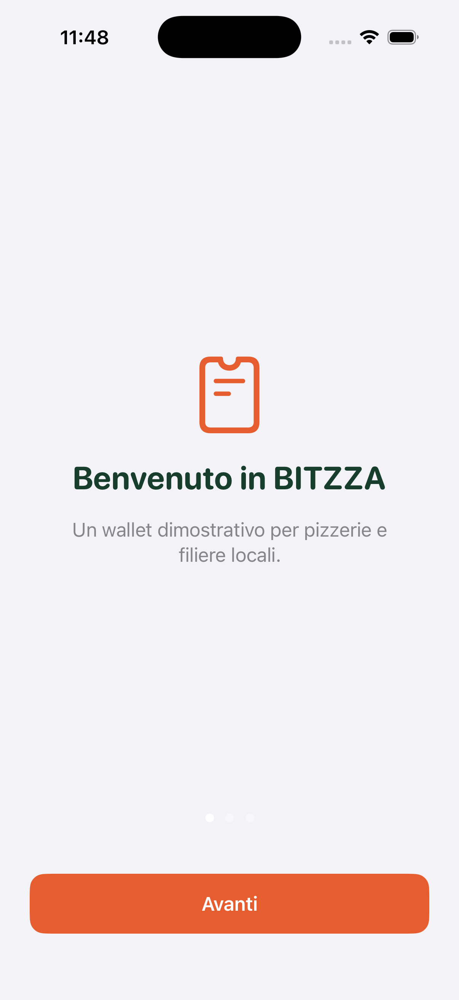
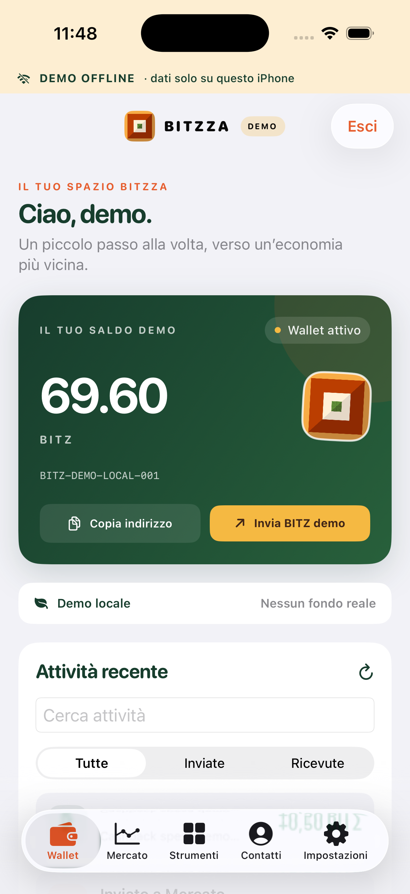

# BITZZA

> Wallet demo full-stack: app iOS nativa (SwiftUI), web (React), API (Node/Express) e prototipo di smart contract (Solidity, Sepolia testnet).

**Solo a scopo dimostrativo.** Nessun fondo reale, nessuna blockchain di produzione, nessuna custodia. Il BITZ è un saldo simulato.

<p align="center"> </p>

**Demo online:** https://bitzza-wallet.vercel.app (API su Render piano gratuito: la prima richiesta può richiedere circa un minuto e i dati si azzerano ai riavvii).

## Cosa dimostra

| Area | Tecnologie | Contenuto |
|---|---|---|
| iOS | SwiftUI, AVFoundation, Keychain, UserDefaults | Wallet, mercato, contatti, onboarding, modalità demo offline |
| Ecosistema | SwiftUI | Pagamento QR, Pizza-to-earn, Consegne, Spesa a casa, Livelli e badge |
| Web | React, Vite, Reown AppKit, wagmi/viem | Wallet, pagina `/swap` con connessione wallet su Sepolia |
| API | Node, Express, SQLite, JWT, Jest | Auth, trasferimenti idempotenti, rate limit, CORS con allowlist |
| Contratti | Solidity, Hardhat | `BitzzaTestToken`, `MockUSDC`, `BitzzaSwap` con 5 test |

## Funzioni dell'app iOS

- **Pagamento QR**: genera e legge `bitzza://pay` e riconosce anche URI `ethereum:`, `bitcoin:`, `solana:`.
- **Pizza-to-earn**: la pizzeria mostra un QR, il cliente guadagna 1 BITZ (una volta al giorno per locale, max 3 al giorno).
- **Consegne**: accetti un lavoro, lo porti a termine in 4 fasi e guadagni in base al mezzo e alla distanza.
- **Spesa a casa**: preventivo con corriere e commissione, pagamento in BITZ, cashback del 2% (max 5 BITZ).
- **Livelli e badge**: XP, serie giornaliera e sei traguardi derivati dalle attività.
- **Swap simulato BITZ/USDC** in stile MetaMask.

Tutto lo stato offline resta sul dispositivo.

## Architettura

```
ios/            App SwiftUI (SessionStore = stato e regole; viste in Views/)
frontend/web/   React + Vite (+ Reown AppKit per /swap)
server.js       API Express + SQLite
contracts/      Hardhat: token di test, MockUSDC, swap (Sepolia)
docs/           Deploy, roadmap, requisiti legali, testi App Store
```

## Avvio rapido

```bash
npm install
cp .env.example .env        # imposta JWT_SECRET (>= 32 caratteri)
npm start                   # API su http://localhost:3000
cd frontend/web && npm install && npm run dev
npm run check               # test API + lint + build web
```

iOS: apri `ios/Bitzza.xcodeproj` in Xcode 15+ ed esegui lo schema **Bitzza** (iOS 17+). Usa "Entra nella demo offline", senza server.

Contratti: `cd contracts && npm install && npx hardhat test`.

## Limiti dichiarati

- I QR sono statici e le ricompense sono simulate: un sistema reale richiederebbe codici firmati dal server e controlli anti-frode.
- Le consegne e i negozi sono dati di esempio.
- Un token reale richiede audit, consulenza legale e conformità (vedi `docs/LEGAL-PRODUCT-BRIEF.md` e `docs/PRODUCTION-REQUIREMENTS.md`).

## Altri documenti

[Deploy](docs/DEPLOY.md) · [Roadmap](docs/PRODUCT-ROADMAP.md) · [Contratti](contracts/README.md) · [iOS](ios/README.md) · [Privacy](docs/privacy.html)
